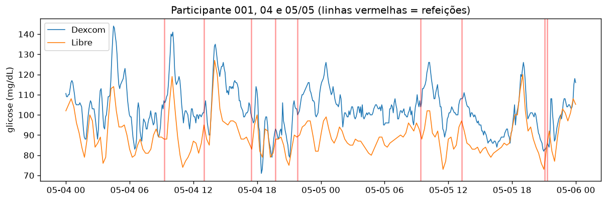
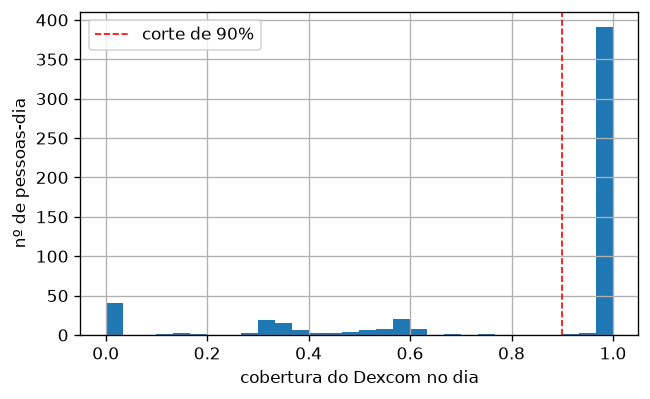
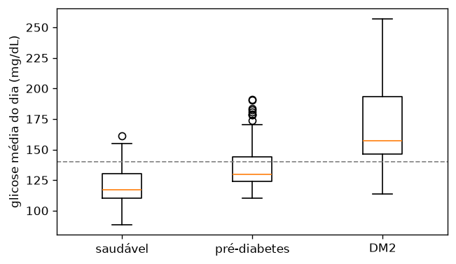
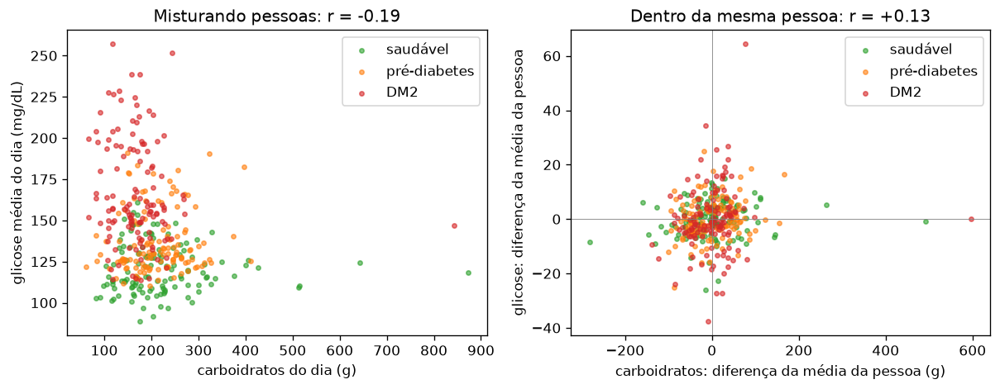

# EDA – CGMacros: o que fizemos e por quê

## 1. Objetivo

Antes de construir a rede neural (RNA) e o algoritmo genético (AG), olhamos os dados com calma. Um modelo só aprende o que está nos dados, e um problema nos dados que passasse despercebido apareceria depois como um "erro do modelo", sem que desse para saber de onde ele veio.

Na prática, a EDA respondeu algumas perguntas concretas: quais dados estão faltando ou foram preenchidos artificialmente, qual dos dois sensores de glicose usar, o que conta como um dia válido e quais participantes têm dados suficientes para o projeto. Ela também mostrou duas coisas que mudam o desenho do modelo: o comportamento (alimentação e atividade) afeta a glicose, mas o efeito só aparece quando comparamos cada pessoa com ela mesma; e quase toda a variação da glicose vem de *quem* é a pessoa. Isso explica por que a rede precisa receber o histórico de cada participante e por que a validação tem que separar pessoas entre treino e teste.

## 2. Os dados

O CGMacros tem 45 participantes acompanhados por cerca de 10 dias. Cada um tem um arquivo CSV com uma linha por minuto. As datas foram deslocadas pelos autores para anonimizar os dados, então o ano não significa nada.

Em cada linha há a glicose de dois sensores colados no braço: o Libre, que mede a cada 15 minutos, e o Dexcom, que mede a cada 5. Como o arquivo tem uma linha por minuto, os minutos entre uma medição e outra foram preenchidos por interpolação. No participante 001, por exemplo, os dois sensores têm valor em quase todos os minutos, mas há cerca de 81 medições reais por dia no Libre e 270 no Dexcom. Os valores também não batem: a média do Libre é 89 mg/dL, e a do Dexcom, 107.

Além da glicose, cada linha traz os dados do Fitbit (frequência cardíaca, calorias gastas no minuto e METs, que faltam em 11 arquivos) e as refeições. Uma refeição aparece em uma única linha, no minuto em que começou, com tipo, calorias, carboidratos, proteína, gordura e fibra; no resto do tempo essas colunas ficam vazias. O participante 001 registrou 43 refeições, cerca de 4 por dia.

O `bio.csv` tem uma linha por participante, com idade, sexo, IMC, HbA1c, glicemia de jejum, insulina e colesterol. Ele não diz a qual grupo clínico cada pessoa pertence, então criamos essa informação a partir da HbA1c (seção 3.4).

Os arquivos não seguem todos o mesmo padrão. Algumas colunas faltam em certos participantes, o tipo de refeição aparece escrito de jeitos diferentes e o participante 007 nem tem uma linha por minuto. No 007, o Libre tem média de 54 mg/dL, contra 113 do Dexcom, o que sugere um sensor com defeito.

*Participante 001, 04 e 05/05. A glicose sobe depois das refeições (linhas vermelhas), sinal de que os horários registrados batem com a resposta do corpo. Mas também há picos sem nenhuma refeição antes, como o de ~144 mg/dL às 4h30 de 04/05.*

## 3. Decisões

### 3.1 Sensor: Dexcom

O Libre parece o sensor mais completo, porque tem valor em praticamente todos os minutos. Olhando de perto o participante 001, porém, a variação de um minuto para o outro é idêntica em blocos de 15: de 84 para 86 mg/dL, por exemplo, o valor sobe exatos 0,1333 por minuto. Glicose real não se comporta assim. Só 1 a cada 15 valores é medido de fato, e o resto é uma reta ligando dois pontos. O Dexcom também é preenchido do mesmo jeito, mas em blocos de 5 minutos.

Repetimos a contagem nos 45 participantes e o padrão se manteve: mediana de ~88 medições reais por dia no Libre e ~242 no Dexcom, ou seja, cerca de 2,7 vezes mais. Por isso escolhemos o Dexcom. Com mais medições, ele tem mais chance de captar picos curtos, que o Libre pode perder entre um ponto e outro.

Também decidimos não misturar os dois. O Libre marca menos que o Dexcom em 44 dos 45 participantes, em média 32 mg/dL a menos, e em alguns casos os dois quase não sobem e descem juntos (correlação entre 0,1 e 0,4). Trocar de sensor no meio do caminho mudaria a glicose em ~30 mg/dL sem que nada tivesse acontecido com a pessoa.

Uma ressalva importante: escolhemos o Dexcom pela resolução, não por ele ser mais preciso. Sem uma medida de referência, não dá para saber qual dos dois está mais perto da glicose real, e valores absolutos como "% do tempo acima de 140 mg/dL" mudam conforme o sensor. O `bio.csv` tem três medições por picada no dedo que poderiam servir de referência, mas só traz o horário, sem a data, e essa comparação ficou de fora.

### 3.2 O que conta como um dia

O registro começa e termina no meio do dia. No 001, vai das 10h30 de 01/05 às 15h59 de 11/05. No primeiro dia falta a madrugada e o café da manhã. No último, o Dexcom para às 9h30 e não registra a única refeição do dia. A média de glicose e o total de carboidratos desses dias sairiam incompletos.

Definimos o dia como a data do calendário, da meia-noite às 23h59, e consideramos um dia bom quando o Dexcom tem valor em pelo menos 90% dos 1440 minutos. O número exato pesa pouco: qualquer corte entre 70% e 95% leva praticamente ao mesmo resultado (393 a 395 dias bons e 42 participantes válidos). Já exigir 100% derrubaria o número de participantes para 22, por falhas de poucos minutos, e abaixo de 70% começam a entrar os dias parciais. A mesma regra resolve os dias da ponta, sem precisar de um filtro separado.

### 3.3 Quem fica e quem sai

O projeto observa os dias 1 a 6 e recomenda os dias 7 a 9, então cada participante precisa de 9 dias bons seguidos. Os dias em que o Dexcom falha aparecem em 21 participantes, mas quase sempre no fim do registro: o sensor para de medir antes de o período acabar. Uma falha no fim só encurta o período; o problema é quando ela cai no meio e quebra a sequência.

Nossa primeira versão dessa análise errou. Ela só aceitava datas com exatamente 1440 linhas e, com isso, jogava fora dias que tinham 1425 (faltando 15 minutos). O resultado era de apenas 35 participantes válidos. Medindo a cobertura em todas as datas, chegamos a 42. Ficaram de fora três:

- **007**: o arquivo não tem uma linha por minuto, e o Libre parece defeituoso;
- **018**: tem cerca de 9 datas quase sem registro no meio do período;
- **026**: o Dexcom falhou no meio do período, nos dias 5 e 6.

### 3.4 Grupo clínico

Como o `bio.csv` não traz o grupo, usamos a HbA1c com os cortes da American Diabetes Association: abaixo de 5,7% é saudável, de 5,7% a 6,4% é pré-diabetes e a partir de 6,5% é DM2. Com esse critério, os números batem exatamente com os descritos no dataset (15, 16 e 14), o que indica que é o mesmo critério dos autores. Depois das exclusões, os grupos ficaram equilibrados, com 14 participantes cada.

### 3.5 Atividade física

A coluna `METs` falta em 11 arquivos. Já `Calories (Activity)` só falta no 007, que já tinha saído, então usamos a soma diária dela. Essa medida inclui o que o corpo gasta em repouso (o total fica em torno de 2600 kcal por dia), então comparar pessoas diferentes por ela não faz muito sentido. O que ela mostra bem é a diferença entre dias da mesma pessoa.

## 4. Achados

### 4.1 A glicose aumenta de grupo para grupo

| | saudável | pré-diabetes | DM2 |
|---|---|---|---|
| glicose média do dia (mg/dL) | 121 | 137 | 167 |
| pico do dia (mg/dL) | 182 | 214 | 279 |
| % do tempo acima de 140 mg/dL | 17% | 34% | 67% |
| carboidratos (g/dia) | 220 | 212 | 170 |

A ordem é a esperada, mas os grupos se sobrepõem: há dias de pré-diabéticos com glicose mais alta que dias de quem tem DM2. Outro detalhe chama atenção na última linha: quem tem DM2 come menos carboidrato, provavelmente por orientação médica. Isso vai ser importante logo abaixo.

### 4.2 O efeito do carboidrato se inverte

Quando juntamos todos os dias de todas as pessoas, a correlação entre carboidratos e glicose sai negativa (−0,19). À primeira vista, comer mais carboidrato baixaria a glicose, o que não faz sentido. A explicação está na tabela anterior: essa comparação é entre pessoas diferentes, e quem tem DM2 tem a glicose mais alta e, ao mesmo tempo, come menos carboidrato.

Quando comparamos cada pessoa com ela mesma, a relação vira positiva (+0,13), e é positiva em 79% dos participantes: no dia em que alguém come mais carboidrato do que costuma, a glicose dele sobe. É um exemplo do paradoxo de Simpson, em que uma relação aparece num sentido nos dados misturados e no sentido contrário dentro de cada grupo.

Com a atividade física o resultado é o esperado. Dentro da mesma pessoa, dias mais ativos têm glicose mais baixa (−0,23), e o efeito é mais forte em quem tem DM2 (−0,35).

### 4.3 Quem é a pessoa explica quase tudo

A glicose média diária varia cerca de 30 mg/dL entre todas as pessoas-dia, mas só uns 9 mg/dL dentro de uma mesma pessoa. Ou seja, cerca de 90% da variação vem de quem é a pessoa, e só o restante muda de um dia para o outro. Por isso, um palpite simples como "a glicose de hoje vai ser igual à de ontem" já erra, em média, só 8,1 mg/dL.

## 5. O que isso muda no projeto

Por causa do paradoxo de Simpson, a rede precisa saber de quem está falando. Ela vai receber a glicose dos dias anteriores e os dados do `bio.csv`. Sem isso, poderia aprender que mais carboidrato baixa a glicose, e o AG, que segue o que a rede prevê, acabaria recomendando comer mais carboidrato.

A validação também precisa separar pessoas. Se dias do mesmo participante estivessem no treino e no teste, a rede acertaria só por reconhecer quem é, e o erro pareceria menor do que é. Por isso vamos usar validação por participante (GroupKFold).

O ponto de comparação certo para a rede é aquele palpite de "hoje igual a ontem": ela só é útil se errar menos que 8,1 mg/dL. Comparar com a média geral faria qualquer modelo parecer bom.

Por fim, convém ajustar as expectativas. Os efeitos do comportamento são fracos e a glicose de uma pessoa varia poucos mg/dL de um dia para o outro. Uma redução prevista de alguns mg/dL no dia 9 é um resultado realista. E é uma previsão do modelo, aprendida de dados observacionais, não uma prova de que o comportamento recomendado causaria essa queda.

## 6. Limites e pendências

Alguns problemas não conseguimos resolver só com os dados:

- refeições podem não ter sido registradas: há picos sem refeição antes, e alguns participantes registram só umas 2 refeições por dia;
- o grupo clínico depende de um único exame de HbA1c, e vários participantes estão perto dos cortes;
- a regra dos 90% diz quanto falta no dia, mas não onde; uma lacuna logo depois de uma refeição esconderia o pico;
- em 9 dias o pico bate em 400 mg/dL, o limite do sensor, então o valor real pode ter sido maior.

Ficam para o pré-processamento:

- padronizar os tipos de refeição (`dinner` e `Dinner`; `snack`, `Snacks` e `snack 1`);
- decidir o que fazer com `Amount Consumed`, que tem valores de até 900% e falta nos participantes 028 e 029;
- tratar os 5 dias com mais de 500 g de carboidrato e o dia sem dados do Fitbit;
- escolher quais 9 dias seguidos de cada participante usar.
